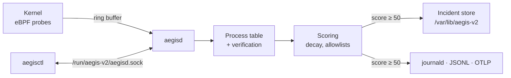

<!-- markdownlint-disable-next-line MD041 -->


[![CI][ci-badge]][ci]
[![Release][release-badge]][releases]
[![License: MIT OR Apache-2.0][license-badge]](#license)
[![Rocky Linux 10][rocky-badge]](docs/installation.md)
[![Rust 1.98+][msrv-badge]](docs/development.md#minimum-rust-version)

[ci-badge]: https://img.shields.io/github/actions/workflow/status/jamesconwaydev/aegis-v2/ci.yml?branch=main&label=CI
[ci]: https://github.com/jamesconwaydev/aegis-v2/actions/workflows/ci.yml
[release-badge]: https://img.shields.io/github/v/release/jamesconwaydev/aegis-v2?include_prereleases&sort=semver
[releases]: https://github.com/jamesconwaydev/aegis-v2/releases
[license-badge]: https://img.shields.io/badge/license-MIT%20OR%20Apache--2.0-blue
[rocky-badge]: https://img.shields.io/badge/Rocky%20Linux-10-10b981
[msrv-badge]: https://img.shields.io/badge/rust-1.98%2B-orange

# Aegis v2

Something on your server just ran a binary out of `/tmp`, then started
knocking on every port in the subnet. Most tools will tell you that
happened, one line each, in a log you read on Monday. Aegis watches the
whole process tree from the kernel, adds those signals up into one score,
and hands you a single incident with the evidence attached.


That's a real run of [`examples/lab/run.sh`](examples/lab) on a Rocky
Linux 10.2 test VM. It uses nothing but copies of the host's own bash
and strace, never leaves the host, and cleans up after itself. Run it on
a throwaway VM and you'll get the same incident.

## What v0.1 does today

v0.1 is an observer. It runs in audit mode only: it scores, records
and reports, and it changes nothing on the host. No process is stopped,
throttled, moved or sandboxed. Ask for `mode = "enforce"` and aegisd
refuses to start, saying it's planned for v0.2.0.

Here's what you get:

- **Kernel probes** for every committed exec (the real path, not
  `argv[0]`), fork, exit, successful `ptrace` attach, `memfd_create`, and outbound
  TCP connects with their outcome.
- **A risk score per process** that halves every 30 seconds of quiet.
  An exec from `/tmp` adds 25, a memfd exec adds 65, an attach to a
  system daemon adds 45, a burst of outbound connects adds 40.
- **Allowlists that can't be fooled by a name.** `dnf`, `gdb` or
  `podman` only get a pass when the binary on disk is RPM-owned and
  unmodified, or matches a SHA-256 you pinned, and the process shows no
  sign of `LD_PRELOAD` or an attached debugger.
- **Incidents, not alerts.** A process whose score reaches 50 opens a
  `would_throttle` incident, and its children's signals count towards
  the same one. At 80 it becomes `would_quarantine`. Each incident is a
  directory under `/var/lib/aegis-v2/incidents`.
- **Telemetry** to journald, a JSON-lines file, and OTLP logs.
- **`aegisctl`** for `status`, `preflight` and `incidents
  list|show|timeline`, with `--json` on all of them.
- **RPMs** for x86_64 and aarch64, a hardened systemd unit, and an
  SELinux module that confines aegisd to its own domain.

### Today versus planned

A `would_quarantine` verdict is a note, not an action. Anything marked
"no" doesn't exist yet, and the [roadmap](docs/roadmap.md) explains how
enforcement is meant to work when it does.

|                                      | v0.1 (today) | Planned |
| ------------------------------------ | ------------ | ------- |
| Kernel probes, scores, incidents     | yes          |         |
| Verified-binary allowlists           | yes          |         |
| journald, JSON-lines, OTLP logs      | yes          |         |
| `would_throttle`, `would_quarantine` | recorded     |         |
| Throttle a process tree              | no           | v0.2.0  |
| Quarantine a process tree            | no           | v0.2.0  |
| Cut a quarantined tree's network     | no           | v0.2.0  |
| BPF LSM escape and write-deny hooks  | no           | v0.2.0  |
| Webhooks, OTLP metrics               | no           | v0.2.0  |
| Honeypot, pcaps, STIX                | no           | v0.3.0  |
| Live migration, Release & Merge      | no           | v0.4.0  |

## What it can and can't catch

It's built to catch the moves an intruder makes after getting a foothold:
running a dropped payload from `/tmp`, `/var/tmp` or `/dev/shm`, running
code that only exists in memory, attaching a debugger to pid 1 or a
system service, and scanning outward over TCP.

It won't reliably catch, in v0.1:

- **Root who knows it's there.** Root can stop aegisd, unload its probes
  or edit its config. Ship telemetry off the host so the record
  survives.
- **Loader tricks done carefully.** The `LD_PRELOAD` and ptrace checks
  read `/proc` just after the exec, and a careful attacker can scrub
  that first. In-kernel capture is planned for v0.2.0.
- **Scripts run as `sh /tmp/x`.** The kernel ran the shell, so that's
  what Aegis sees. A script with a `#!` line run directly is caught.
- **UDP, and scans spread across many processes.** Only TCP connects
  are counted, per process.
- **Allowlisting inside containers.** Container binaries never verify
  against the host's files, so allowlists don't apply to them.

The [threat model](docs/threat-model.md) has every known gap and why.

### What it needs, and what it can touch

aegisd runs as root under systemd, but with six capabilities rather
than all of them: `CAP_BPF` and `CAP_PERFMON` to load and attach the probes,
`CAP_SYS_ADMIN` for the BPF LSM programs, `CAP_SYS_PTRACE` to read other
processes' `/proc` entries, `CAP_DAC_READ_SEARCH` to hash any
executable, and `CAP_NET_ADMIN` so `nft` can block a quarantined tree's
traffic in enforce mode. The filesystem is read-only to it apart from
`/var/lib/aegis-v2` and `/run/aegis-v2`, it can't gain privileges, and
SELinux confines it to its own `aegisd_t` domain. Its control socket
answers root only.

That protects the host from a compromised aegisd. It doesn't protect
aegisd from root, and in v0.1 nothing it does changes the host anyway:
the end-to-end tests check that `/etc` is byte-for-byte unchanged.
[Installation](docs/installation.md#the-systemd-unit) has the
full unit.

## What one incident looks like

The lab's run above, as Aegis recorded it. Times are milliseconds from
the first signal; scores are the incident's.

```text
process tree
  1653422  /tmp/aegis-lab.9mGtdQ/bash      unverified   root, opened the incident
  └─ 1653425  /tmp/aegis-lab.9mGtdQ/strace unverified   joined at its exec

  ms   pid      signal                     adds  score  verdict
   0   1653422  tmp_exec                    25     25   below 50, not recorded
  14   1653422  egress_scan (10 targets)    40     65   would_throttle, opens
  22   1653425  tmp_exec                    25     65   would_throttle, joins
  34   1653425  ptrace_system_daemon        45    110   would_quarantine

/var/lib/aegis-v2/incidents/AEG-20261021-233357-76d2c9b5faf63e86/
├── incident.json     the summary: tree, 4 pieces of evidence, peak 110
└── timeline.jsonl    one line per decision that changed something
```

The child's own `tmp_exec` doesn't raise the incident score: each kind
counts once, at its strongest, across the tree. The two files are in
[`examples/lab`](examples/lab), unedited, and
[incidents](docs/incidents.md) documents every field. Nothing was
throttled or quarantined, because v0.1 doesn't do that.

## How the score adds up

| Signal                                | Adds | Weight key             |
| ------------------------------------- | ---- | ---------------------- |
| Exec from `/tmp`, `/var/tmp`, tmpfs   | 25   | `tmp_exec`             |
| `memfd_create`                        | 20   | `memfd_create`         |
| Exec of a memfd                       | 65   | `memfd_exec`           |
| ptrace attach to pid 1 or a service   | 45   | `ptrace_system_daemon` |
| 20 targets or 10 failed connects, 2 s | 40   | `egress_scan`          |

| Score     | Verdict            | In v0.1                 |
| --------- | ------------------ | ----------------------- |
| below 50  | none               | debug log only          |
| 50 to 79  | `would_throttle`   | incident on disk        |
| 80 and up | `would_quarantine` | incident on disk        |

Each signal kind counts once per process, so ten `memfd_create` calls
are worth 20, not 200. Every component halves after 30 seconds of quiet:
a 45-point attach is worth 22.5 half a minute later, and about 6 after
90 seconds. Once a tree is in an incident, it's judged on the strongest
of each kind across all its members, which is how the lab's scan in one
process and attach in another add up to 110. Weights, thresholds and the
half-life are all in the config. [Scoring](docs/scoring.md) covers the
rest, and how to baseline a host before you trust any of it.

## How it fits together



[Architecture](docs/architecture.md) walks through each box.

## Quickstart

Grab both RPMs for your architecture from the
[releases page][releases], then on a Rocky Linux 10 host, as root:

```sh
dnf install ./aegis-v2-*.x86_64.rpm ./aegis-v2-selinux-*.noarch.rpm
aegisctl preflight
systemctl enable --now aegisd
# leave it in audit mode for 48 to 72 hours of normal work
aegisctl incidents list
```

Every incident you see after those few days is either something worth a
look or a false positive you can allowlist. [Scoring](docs/scoring.md)
covers the baselining, and [installation](docs/installation.md) covers
aarch64 and what `preflight` wants from your kernel.

## Compatibility

| Distribution                | Kernel | Arch    | Tested                    |
| --------------------------- | ------ | ------- | ------------------------- |
| Rocky Linux 10.2            | 6.12   | x86_64  | end to end                |
| Rocky Linux 10.2            | 6.12   | aarch64 | end to end                |
| Other EL10 (Alma, RHEL)     | 6.12+  | either  | not yet; reports welcome  |
| EL9 or older, other distros |        |         | not supported             |

It needs kernel BTF, cgroup v2 and the BPF LSM, which Rocky 10.2 enables
by default. `aegisctl preflight` checks each one and tells you the fix.

## Documentation

| Page                                       | What it covers                  |
| ------------------------------------------ | ------------------------------- |
| [Overview](docs/overview.md)               | Concepts and vocabulary         |
| [Architecture](docs/architecture.md)       | Probes, pipeline, data flow     |
| [Installation](docs/installation.md)       | RPMs, first start, uninstall    |
| [Preflight](docs/preflight.md)             | Every host check and its fix    |
| [Configuration](docs/configuration.md)     | Every setting and its default   |
| [Scoring](docs/scoring.md)                 | Weights, decay, tuning          |
| [Incidents](docs/incidents.md)             | On-disk format and reading them |
| [Telemetry](docs/telemetry.md)             | journald, JSONL, OTLP           |
| [aegisctl](docs/aegisctl.md)               | Command reference               |
| [SELinux](docs/selinux.md)                 | The `aegisd_t` policy           |
| [Threat model](docs/threat-model.md)       | What it catches, what it can't  |
| [Troubleshooting](docs/troubleshooting.md) | Common problems                 |
| [FAQ](docs/faq.md)                         | Short answers                   |
| [Development](docs/development.md)         | Building and testing            |
| [Releasing](docs/releasing.md)             | Cutting a release               |
| [Roadmap](docs/roadmap.md)                 | What's planned, by version      |

## Contributing

Bug reports, false positives and pull requests are all welcome.
[CONTRIBUTING.md](CONTRIBUTING.md) has the details, and security problems
go through [SECURITY.md](SECURITY.md), not the issue tracker.

## License

The userspace code (`aegisd`, `aegisctl` and the libraries they use) is
dual-licensed under [MIT](LICENSE-MIT) or [Apache-2.0](LICENSE-APACHE),
at your option. The eBPF programs in `aegis-ebpf` are
[GPL-2.0-only](LICENSE-GPL-2.0), because the kernel requires it.
