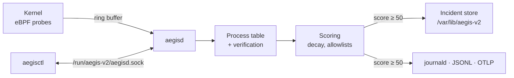

<!-- markdownlint-disable-next-line MD041 -->


[![CI][ci-badge]][ci]
[![Release][release-badge]][releases]
[![License: MIT OR Apache-2.0][license-badge]](#license)
[![Rocky Linux 10][rocky-badge]](docs/installation.md)
[![Rust 1.98+][msrv-badge]](docs/development.md#minimum-rust-version)

[ci-badge]: https://img.shields.io/github/actions/workflow/status/jamesconwaydev/aegis-v2/ci.yml?branch=main&label=CI
[ci]: https://github.com/jamesconwaydev/aegis-v2/actions/workflows/ci.yml
[release-badge]: https://img.shields.io/github/v/release/jamesconwaydev/aegis-v2?include_prereleases&sort=semver
[releases]: https://github.com/jamesconwaydev/aegis-v2/releases
[license-badge]: https://img.shields.io/badge/license-MIT%20OR%20Apache--2.0-blue
[rocky-badge]: https://img.shields.io/badge/Rocky%20Linux-10-10b981
[msrv-badge]: https://img.shields.io/badge/rust-1.98%2B-orange

# Aegis v2

Something on your server just ran a binary out of `/tmp`, then started
knocking on every port in the subnet. Most tools will tell you that
happened, one line each, in a log you read on Monday. Aegis watches the
whole process tree from the kernel, adds those signals up into one score,
and hands you a single incident with the evidence attached.

## What v0.1 does today

v0.1 is an observer. It runs in audit mode only: it scores, records
and reports, and it changes nothing on the host. No process is stopped,
throttled, moved or sandboxed. Ask for `mode = "enforce"` and aegisd
refuses to start, saying it's planned for v0.2.0.

Here's what you get:

- **Kernel probes** for every committed exec (the real path, not
  `argv[0]`), fork, exit, successful `ptrace` attach, `memfd_create`, and outbound
  TCP connects with their outcome.
- **A risk score per process** that halves every 30 seconds of quiet.
  An exec from `/tmp` adds 25, a memfd exec adds 65, an attach to a
  system daemon adds 45, a burst of outbound connects adds 40.
- **Allowlists that can't be fooled by a name.** `dnf`, `gdb` or
  `podman` only get a pass when the binary on disk is RPM-owned and
  unmodified, or matches a SHA-256 you pinned, and the process shows no
  sign of `LD_PRELOAD` or an attached debugger.
- **Incidents, not alerts.** A process whose score reaches 50 opens a
  `would_throttle` incident, and its children's signals count towards
  the same one. At 80 it becomes `would_quarantine`. Each incident is a
  directory under `/var/lib/aegis-v2/incidents`.
- **Telemetry** to journald, a JSON-lines file, and OTLP logs.
- **`aegisctl`** for `status`, `preflight` and `incidents
  list|show|timeline`, with `--json` on all of them.
- **RPMs** for x86_64 and aarch64, a hardened systemd unit, and an
  SELinux module that confines aegisd to its own domain.

Quarantine, the honeypot, live migration and Release & Merge are
[on the roadmap](docs/roadmap.md). None of them ship in v0.1.

## How it fits together



[Architecture](docs/architecture.md) walks through each box.

## Quickstart

Grab both RPMs for your architecture from the
[releases page][releases], then on a Rocky Linux 10 host, as root:

```sh
dnf install ./aegis-v2-*.x86_64.rpm ./aegis-v2-selinux-*.noarch.rpm
aegisctl preflight
systemctl enable --now aegisd
# leave it in audit mode for 48 to 72 hours of normal work
aegisctl incidents list
```

Every incident you see after those few days is either something worth a
look or a false positive you can allowlist. [Scoring](docs/scoring.md)
covers the baselining, and [installation](docs/installation.md) covers
aarch64 and what `preflight` wants from your kernel.

## Documentation

| Page                                       | What it covers                  |
| ------------------------------------------ | ------------------------------- |
| [Overview](docs/overview.md)               | Concepts and vocabulary         |
| [Architecture](docs/architecture.md)       | Probes, pipeline, data flow     |
| [Installation](docs/installation.md)       | RPMs, first start, uninstall    |
| [Preflight](docs/preflight.md)             | Every host check and its fix    |
| [Configuration](docs/configuration.md)     | Every setting and its default   |
| [Scoring](docs/scoring.md)                 | Weights, decay, tuning          |
| [Incidents](docs/incidents.md)             | On-disk format and reading them |
| [Telemetry](docs/telemetry.md)             | journald, JSONL, OTLP           |
| [aegisctl](docs/aegisctl.md)               | Command reference               |
| [SELinux](docs/selinux.md)                 | The `aegisd_t` policy           |
| [Threat model](docs/threat-model.md)       | What it catches, what it can't  |
| [Troubleshooting](docs/troubleshooting.md) | Common problems                 |
| [FAQ](docs/faq.md)                         | Short answers                   |
| [Development](docs/development.md)         | Building and testing            |
| [Releasing](docs/releasing.md)             | Cutting a release               |
| [Roadmap](docs/roadmap.md)                 | What's planned, by version      |

## Contributing

Bug reports, false positives and pull requests are all welcome.
[CONTRIBUTING.md](CONTRIBUTING.md) has the details, and security problems
go through [SECURITY.md](SECURITY.md), not the issue tracker.

## License

The userspace code (`aegisd`, `aegisctl` and the libraries they use) is
dual-licensed under [MIT](LICENSE-MIT) or [Apache-2.0](LICENSE-APACHE),
at your option. The eBPF programs in `aegis-ebpf` are
[GPL-2.0-only](LICENSE-GPL-2.0), because the kernel requires it.
