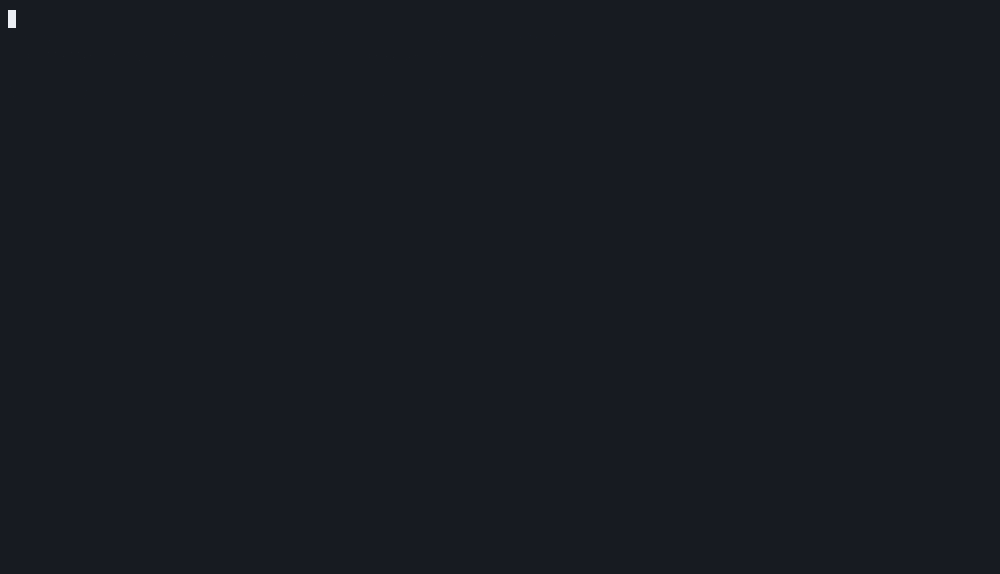

<!-- markdownlint-disable-next-line MD041 -->


[![CI][ci-badge]][ci]
[![Release][release-badge]][releases]
[![License: MIT OR Apache-2.0][license-badge]](#license)
[![Rocky Linux 10][rocky-badge]][wiki-install]
[![OpenSSF Scorecard][scorecard-badge]][scorecard]
[![OpenSSF Best Practices][bp-badge]][bp]
[![Discussions][discussions-badge]][discussions]

[ci-badge]: https://img.shields.io/github/actions/workflow/status/jamesconwaydev/aegis-v2/ci.yml?branch=main&label=CI
[ci]: https://github.com/jamesconwaydev/aegis-v2/actions/workflows/ci.yml
[release-badge]: https://img.shields.io/github/v/release/jamesconwaydev/aegis-v2?include_prereleases&sort=semver
[releases]: https://github.com/jamesconwaydev/aegis-v2/releases
[license-badge]: https://img.shields.io/badge/license-MIT%20OR%20Apache--2.0-blue
[rocky-badge]: https://img.shields.io/badge/Rocky%20Linux-10-10b981
[scorecard-badge]: https://api.scorecard.dev/projects/github.com/jamesconwaydev/aegis-v2/badge
[scorecard]: https://scorecard.dev/viewer/?uri=github.com/jamesconwaydev/aegis-v2
[bp-badge]: https://www.bestpractices.dev/projects/16018/badge
[bp]: https://www.bestpractices.dev/projects/16018
[discussions-badge]: https://img.shields.io/github/discussions/jamesconwaydev/aegis-v2
[discussions]: https://github.com/jamesconwaydev/aegis-v2/discussions
[wiki]: https://github.com/jamesconwaydev/aegis-v2/wiki
[wiki-install]: https://github.com/jamesconwaydev/aegis-v2/wiki/Installation
[wiki-threat]: https://github.com/jamesconwaydev/aegis-v2/wiki/Threat-model

# Aegis v2

A binary runs out of `/tmp`. A second later it attaches a debugger to a
system service and starts sweeping the subnet. On most boxes that's three
log lines in three places, and you read them on Monday. Aegis reads it as
one story. It watches every process tree from the kernel with eBPF, adds
the signals up into a single score, and opens one incident with the
evidence attached. Switch on enforce mode and it acts: the tree is held
in the kernel, frozen and cut off from the network, alive and waiting
for you to decide.

I built it for my own Rocky Linux servers. It's Rust, it ships as an RPM
with its own SELinux policy, and it starts out only watching.



That's a real run of [`examples/lab/run.sh`](examples/lab) on a Rocky
10.2 VM. It uses copies of the host's own bash and strace, never leaves
the box, and cleans up after itself, so you can run it on a test VM and
watch the same thing happen. This run is in enforce mode; in audit mode
you get the same incident, and nothing is touched.

## Install

Rocky Linux 10, x86_64 or aarch64. Every release is signed and ships with
SBOMs and build provenance; [Installation][wiki-install] shows how to
check one before you install it.

```sh
VERSION=0.2.3 ARCH=x86_64   # or aarch64
base=https://github.com/jamesconwaydev/aegis-v2/releases/download/v$VERSION
curl -fsSLO "$base/aegis-v2-$VERSION-1.el10.$ARCH.rpm" \
     -O "$base/aegis-v2-selinux-$VERSION-1.el10.noarch.rpm"
dnf install "./aegis-v2-$VERSION-1.el10.$ARCH.rpm" \
    "./aegis-v2-selinux-$VERSION-1.el10.noarch.rpm"
aegisctl preflight
systemctl enable --now aegisd
```

`preflight` checks for kernel BTF, cgroup v2 and the BPF LSM, and tells
you the fix for anything missing. Rocky 10.2 has all three out of the box.

## Quick start

Leave it in audit mode for two or three days of normal work. It scores
and records everything and touches nothing. Then look at what it found:

```sh
aegisctl incidents list
aegisctl incidents show <id>
```

Each incident is either worth your time or a false positive you
allowlist. Once the list goes quiet, set `mode = "enforce"` in
`/etc/aegis-v2/config.toml` and `systemctl reload aegisd`. From then on,
a held tree waits for one of two commands: `aegisctl incidents release
<id>` gives it back, and `aegisctl incidents kill <id>` ends it.

## What it does

- **Watches from the kernel.** eBPF probes on exec (the real path, not
  `argv[0]`), fork, exit, ptrace attach, `memfd_create` and outbound TCP
  connects. Each new program's environment is read at exec, before its
  first instruction, so a preloaded library can't scrub itself before
  the check.
- **Scores behaviour, not names.** An exec from `/tmp` adds 25, a memfd
  exec 65, an attach to a system daemon 45, a connect burst 40. Scores
  halve every 30 seconds of quiet, and a whole tree counts as one.
- **Trusts binaries you can prove.** `dnf`, `gdb` and `podman` only get a
  pass when the file on disk is RPM-owned and unmodified, or matches a
  hash you pinned, with no `LD_PRELOAD` or debugger in sight.
- **Writes incidents, not alerts.** One directory per incident: the tree,
  the evidence, and a timeline of every decision. Out to journald,
  JSON-lines, OTLP logs and metrics, and webhooks (JSON or Slack).
- **Throttles at 50, quarantines at 80**, in enforce mode. Throttle caps
  the tree's CPU and memory in its own scope. Quarantine holds it with
  BPF LSM programs (no fork, connect, mount, ptrace, module loads or
  writes), freezes it with systemd, and drops its traffic in nftables.
  Nothing gets killed unless you say so.
- **Runs tight.** Six capabilities instead of all of them, a read-only
  filesystem outside its own state, socket and log directories, its own
  SELinux domain, and a control socket that answers root only. `/etc`
  is left byte for byte as it was.

## What it won't catch

Better you hear it here than find out during an incident.

- **Root who knows it's there.** Root can stop aegisd and unload its
  probes. Ship telemetry off the box so the record survives.
- **UDP, and scans split across many processes.** Only TCP connects
  count, per process.
- **`sh /tmp/x`.** The kernel ran the shell, so that's what Aegis sees. A
  script run directly through its `#!` line is caught.
- **Writes made before the hold.** The hold lands milliseconds after the
  score crosses 80, and anything written before then is on disk.
- **The seconds after an nftables reload.** `systemctl reload nftables`
  flushes every quarantined tree's drop rule. aegisd puts them back
  within about 10 seconds. Until then the tree is still frozen and held,
  but nothing drops its traffic.

The [threat model][wiki-threat] lists every known gap and why it's there.

## Documentation

Everything lives in the [wiki][wiki]: installation and uninstalling,
configuration, scoring and baselining, reading incidents, telemetry,
`aegisctl`, SELinux, the threat model, troubleshooting and the
[roadmap](docs/roadmap.md). The same pages are in [`docs/`](docs),
versioned with each release.

## Contributing

False positives are the most useful thing you can send right now:
there's an issue form for them. Questions and ideas go in
[Discussions][discussions], and the
[good first issues](https://github.com/jamesconwaydev/aegis-v2/labels/good%20first%20issue)
each name the file to change and the test to add. Read
[CONTRIBUTING.md](CONTRIBUTING.md) before you send code.

Found a security problem? Report it privately; see
[SECURITY.md](SECURITY.md).

## License

`aegisd`, `aegisctl` and their libraries are dual-licensed under
[MIT](LICENSE-MIT) or [Apache-2.0](LICENSE-APACHE), at your option. The
eBPF programs in `aegis-ebpf` are [GPL-2.0-only](LICENSE-GPL-2.0),
because the kernel requires it.
