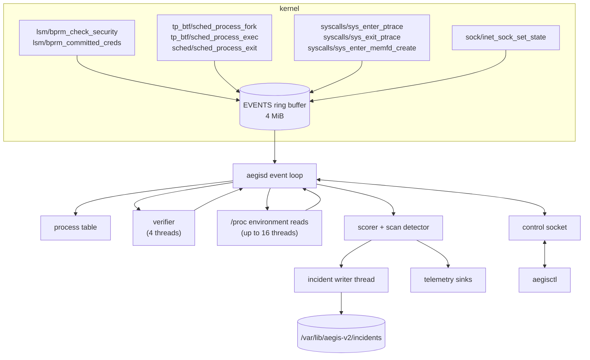

# Architecture

Follow one event from the kernel to an incident on disk. Written for
contributors, and for operators who want to know what's running on
their host.

## Components

| Piece          | What it is                                         |
| -------------- | -------------------------------------------------- |
| `aegis-ebpf`   | The eBPF programs. GPL-2.0-only.                   |
| `aegis-common` | The event layout shared by kernel and userspace.   |
| `aegisd`       | The root daemon: loads the probes, scores, records |
| `aegis-proto`  | The control-socket protocol.                       |
| `aegisctl`     | The admin CLI.                                     |
| `aegis-sim`    | Attack simulators for the e2e tests. Never shipped |
| `xtask`        | Build, RPM and e2e automation.                     |

The RPM installs `aegisd` and `aegisctl`. The eBPF object is compiled
into `aegisd`, so there's nothing else to deploy.

## Data flow

## Kernel side

The probes attach at startup. aegisd fails to start unless all nine
attach. The last five are ordinary tracepoints; `aegisctl status` shows
them with a `tracepoint/` prefix.

| Probe               | Hook                              | Emits       |
| ------------------- | --------------------------------- | ----------- |
| `aegis_exec_check`  | `lsm/bprm_check_security`         | nothing     |
| `aegis_exec`        | `lsm/bprm_committed_creds`        | Exec        |
| `aegis_fork`        | `tp_btf/sched_process_fork`       | Fork        |
| `aegis_exec_env`    | `tp_btf/sched_process_exec`       | ExecEnv     |
| `aegis_exit`        | `sched/sched_process_exit`        | Exit        |
| `aegis_ptrace`      | `syscalls/sys_enter_ptrace`       | nothing     |
| `aegis_ptrace_exit` | `syscalls/sys_exit_ptrace`        | Ptrace      |
| `aegis_memfd`       | `syscalls/sys_enter_memfd_create` | MemfdCreate |
| `aegis_connect`     | `sock/inet_sock_set_state`        | Connect     |

Two of them are BPF LSM programs, which is why the BPF LSM has to be
enabled (see [preflight](preflight.md#bpf-lsm)). They only observe:
both return 0, and the kernel's decision is never changed.

### Exec

Exec uses two hooks so that the reported path is the file the user ran,
not its interpreter, and only for execs that succeed.

1. `bprm_check_security` runs once per binary-format rewrite. On the
   first one, the file named in the `execve`, the probe resolves its
   real path with `bpf_d_path`, notes its inode and device, and flags it
   if it lives on tmpfs, under `/tmp/`, `/var/tmp/` or `/dev/shm/`, or
   is a memfd.
2. `bprm_committed_creds` runs once the exec can no longer fail. It
   emits the event with the record from step 1, so a failed exec never
   produces an event.

If no record matches (tracing started mid-exec), the commit hook
classifies its own file and sets the `EXEC_FALLBACK` flag. For a script
that's the interpreter.

Paths are carried in a 256-byte field. A longer path is truncated and
flagged `PATH_TRUNCATED`.

### ptrace

The entry tracepoint notes the request and target of every
`PTRACE_ATTACH` or `PTRACE_SEIZE`. The exit tracepoint emits the event
only if the call returned 0, so an attach the kernel refused never
reaches aegisd.

### Connect

`inet_sock_set_state` fires twice per outbound TCP connect: once at
`SYN_SENT` and once for the outcome (established, or the socket error).
The outcome often fires in softirq context, so the probe keeps the first
event's process details and reuses them. Only TCP is observed.

### Kernel struct offsets

The probes read fields such as `task_struct.real_parent`. Rust eBPF has
no CO-RE, so at startup aegisd reads each offset from
`/sys/kernel/btf/vmlinux` and patches it into the object before loading.
A kernel update needs no rebuild.

### Lost events

When the ring buffer is full, the probe counts the event in a per-CPU
`DROPPED` map instead of writing it. `aegisctl status` shows the total
as `dropped events`.

## Userspace

### Process table

aegisd keeps a table of live processes, keyed by thread-group id and
start time, so a recycled pid never inherits an old process's score. A
process first seen mid-life (one that predates aegisd) gets its
executable and SELinux domain from `/proc`, once its start time
confirms the pid hasn't been reused. Every 60 seconds aegisd sweeps out
processes the kernel has reaped but whose exit event was lost.

### Verification

aegisd only verifies executables that an allowlist entry or a pin
names. Every other exec stays `unverified`, with no `rpm` call and no
hashing: a verdict could only ever matter for those paths.

For an allowlisted or pinned exec, on up to four threads, off the event
loop, aegisd:

1. opens the same path under pid 1's root (`/proc/1/root`) without
   following a final symlink and without blocking, and checks it's a
   regular file and the very inode the kernel executed. A FIFO, a
   device or a symlink at that path is `unverified`;
2. if the path is pinned in the config, compares its SHA-256 with the
   pin: `pinned` on a match, `modified` otherwise;
3. otherwise runs `/usr/bin/rpm -qf` for an owner and `rpm -qf --dump`
   for the recorded size, mode and SHA-256, and compares:
   `rpm_owned:<package>` or `modified`;
4. returns `unverified` for anything else.

"Not owned" counts only when rpm exits 1 with its own `is not owned by
any package` line and nothing on stderr. A timeout (2 seconds per call),
a spawn failure, any other exit code or any other message is
indeterminate: `unverified`, and not cached, so the next exec asks
again.

Verdicts are cached per file identity (device, inode, size, mtime and
ctime), so a rewritten file is checked again. The cache is emptied on
reload. At startup and on reload, every allowlisted path is verified
ahead of time so the first exec of it is a cache hit.

### Environment checks

A verified binary can still run someone else's code, through the
dynamic loader or a debugger. So for a process whose executable is
allowlisted or pinned, or whose SELinux type is in
`excluded_selinux_domains`, aegisd waits for its environment before it
trusts it. `LD_PRELOAD`, `LD_AUDIT` or `LD_LIBRARY_PATH` in it marks the
process as tainted, and so does an environment that can't be read.

For every exec, the `sched_process_exec` tracepoint reads the new
image's environment (`mm->env_start` to `env_end`) before any of the
image's code runs, 256 bytes at a time up to 32 KiB, and sends the
verdict as its own event. Only the flags cross to userspace, never the
environment. Past 32 KiB, or on a failed read, it counts as unreadable.

A process that was running before aegisd started has no exec to catch,
so aegisd reads its `/proc/<pid>/environ` instead. Those reads run on
their own threads, at most 16 at once, because a process can make one
block for good. One that finds a different image, or reads empty,
counts as unreadable, as does any read refused because 16 are already
running.

Either way the answer must land within 1 second, and at most 256 can
be awaited at once. Past either limit the process counts as tainted.

A process that a host-side tracer attached to with ptrace is tainted
too. Its children inherit the mark at fork, and its next exec clears
it.

A tainted process gets no allowlist modifier at all; see
[scoring](scoring.md#when-an-allowlist-is-withheld).

### Holding signals

A signal that needs a verdict or an environment still being read
is held for up to 6 seconds, then scored with whatever is known by
then: `unverified` for a missing verdict, tainted for a missing
environment. That's two `rpm` calls at their timeout plus the hash.
Without the hold, `runc` copying itself into a memfd would score before
its verification landed. At most 64 signals are held per process and
8,192 in all; past either cap a signal scores at once, and counts as a
defer queue overflow.

### Scoring and incidents

The scorer turns signals into a per-process score and a tier; see
[scoring](scoring.md). A decision at throttle or above goes two ways:

- to the **incident writer**, a separate thread fed by a 256-slot
  queue, which writes the incident to disk with `fsync`. If the queue
  is full the decision is dropped and counted (`incidents dropped` in
  `aegisctl status`), and the next decision records in its place.
- to the **telemetry sinks**, from the event loop. Each sink is best
  effort and never blocks the loop. See [telemetry](telemetry.md).

Once an incident is open, a decision only goes either way when it adds
something: the incident's tier rose, a process showed a signal kind for
the first time, or 60 seconds have passed since the incident last
recorded. The rest are counted as `incident repeats not recorded`. See
[incidents](incidents.md#how-an-incident-forms).

### Control socket

`aegisctl` talks to aegisd over `/run/aegis-v2/aegisd.sock`, a Unix
socket with mode 0600 in a 0700 directory. aegisd checks each peer's uid
with `SO_PEERCRED` and answers only root. The protocol is one JSON
request per line and one JSON response per line, with requests capped
at 64 KiB, 16 connections at a time, and idle clients dropped after
30 seconds. A lock file beside the socket stops a second aegisd from
starting.

### Reload and shutdown

`SIGHUP` (`systemctl reload aegisd`) re-reads the config. A bad file is
logged and the old config stays. Scoring, thresholds and allowlists
apply at once. Telemetry and the incident directory take effect at the
next restart. The verdict cache is emptied, so every allowlisted path
is verified again.

On `SIGTERM`, aegisd scores every held signal, detaches the probes,
lets the incident writer finish its queue, removes the socket, and
exits 0. If the probe event stream ends for any other reason, aegisd
exits non-zero, and systemd restarts it.

## Where to go next

- [Scoring](scoring.md) for the rules the scorer applies.
- [Development](development.md) to build and test it yourself.
